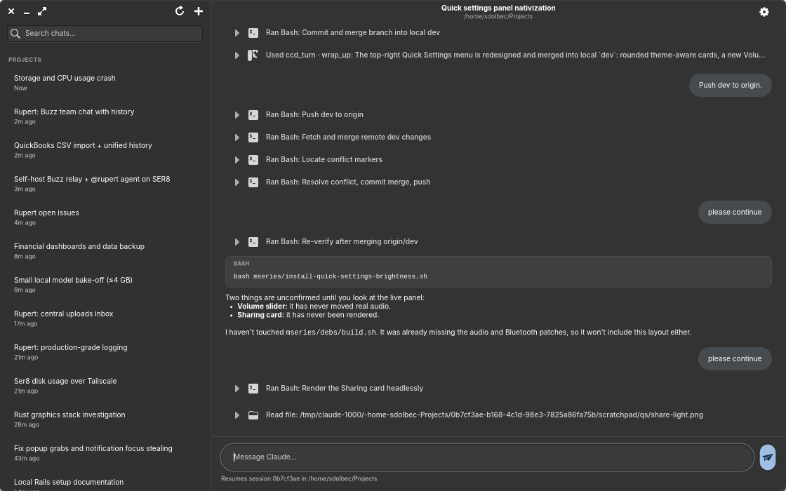
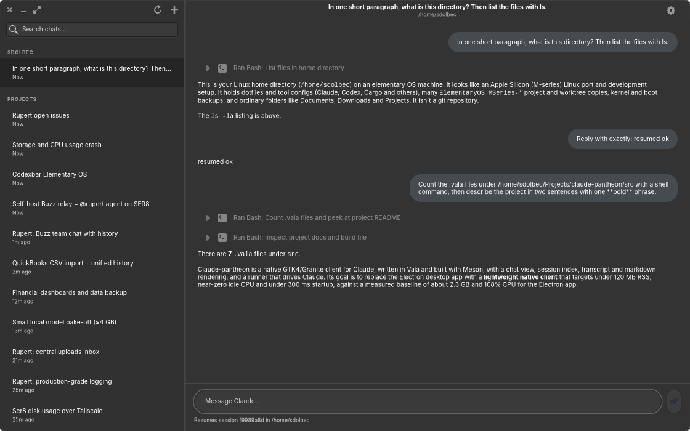

# Claude for Pantheon

A native elementary OS client for Claude, written in Vala with GTK4 and
Granite 7. It reads the Claude Code transcripts already on disk under
`~/.claude/projects` and talks to Claude through the `claude` command line
tool, so it needs no Electron, no embedded browser and no extra account setup.



## What it does

- **Browse every chat.** The sidebar lists sessions grouped by project and
  sorted by last activity, with the session's custom title (or its first
  prompt) and a relative time. A search box filters by title or project.
- **Read transcripts as chat.** User prompts are bubbles; assistant text gets
  bold, italics, inline code, headings, lists and fenced code blocks in
  monospace. Tool calls collapse into one-line rows ("Ran Bash: …",
  "Edited file …") that expand on click to show the input and the result.
- **Talk to Claude.** Type at the bottom to continue the selected session
  (`claude --resume <id>` in that session's working directory) or press
  Ctrl+N for a new chat. Replies stream in live, tool calls appear as rows as
  they happen, and the stop button (or Esc) kills the subprocess.
- **Stay light.** 74 MB RSS and 0.0 % CPU idle with a chat open, about
  130 ms to a mapped window, against 2.4 GB and a full core for the Electron
  app. Transcripts parse on a worker thread, long chats render in idle
  batches, tool results only become widgets when expanded, the cairo
  renderer keeps Mesa out of the process, the window shadow is a flat
  outline and the text cursor does not blink, because each of those cost
  real CPU or memory here. [docs/PERFORMANCE.md](docs/PERFORMANCE.md) has the
  numbers and the reasoning.
- **Looks native.** Granite widgets, Pantheon typography and header bars, and
  it follows the system light/dark preference.



## Build and run

Requires `valac`, `meson`, `ninja`, GTK 4, Granite 7, JSON-GLib and GIO.

```bash
meson setup build
ninja -C build
./build/claude-pantheon
```

To install the desktop entry and icon system-wide:

```bash
sudo ninja -C build install
sudo gtk-update-icon-cache -f -t /usr/share/icons/hicolor
```

`meson test -C build` runs the transcript parser against a small committed
sample; `./build/transcript-dump <file.jsonl>` prints what the chat view would
show for any transcript and how long it took to parse.

## Where things live

- Transcripts are read from `~/.claude/projects/<project-slug>/<session>.jsonl`
  and never modified by this app; new chats and replies are written there by
  the `claude` tool itself.
- A small title index is cached in `~/.cache/claude-pantheon/sessions.json`
  so the sidebar fills without re-reading every file.
- The `claude` binary is found from `$CLAUDE_BIN`, then `PATH`, then the
  newest `~/.config/Claude/claude-code/*/*/claude` bundled with
  claude-desktop, then `~/.local/bin/claude`.

## Tool permissions

In print mode the `claude` tool cannot ask for permission interactively, so
the menu (top right) chooses how it should behave: ask (the default, which
means it denies anything your Claude Code settings do not already allow),
accept file edits, plan only, or bypass permissions. The choice applies to
the next message you send.

## Environment variables

| Variable | Effect |
|---|---|
| `CLAUDE_BIN` | Path of the `claude` executable to run. |
| `CLAUDE_PANTHEON_RENDERER` | GSK renderer (`cairo` by default; `gl`, `ngl`, `vulkan` cost ~180 MB more on Asahi Mesa). |
| `CLAUDE_PANTHEON_DEBUG` | Log startup time and every stream event to stderr. |
| `CLAUDE_PANTHEON_OPEN` | Session id prefix to open at start. |
| `CLAUDE_PANTHEON_SEND` | Prompt to send automatically 1.5 s after start. |
| `CLAUDE_PANTHEON_SCREENSHOT` | Write a PNG of the window after `CLAUDE_PANTHEON_SCREENSHOT_DELAY` ms (default 4000). Used for the docs screenshots since this desktop has no screenshot D-Bus interface. |

## Benchmarks

`./bench.sh <process-name> [seconds]` sums RSS across the process tree rooted
at every process with that name and averages CPU over the window:

```bash
./bench.sh claude-pantheon 20
./bench.sh claude-desktop 20
```

## Not done yet

- The composer is a single-line entry; paste multi-line prompts into one line
  or send them in several messages.
- Images in transcripts show as `[image]`; thinking blocks are skipped.
- Sidebar titles come from the first prompt or Claude Code's own custom
  title; renaming from this app is not implemented.
