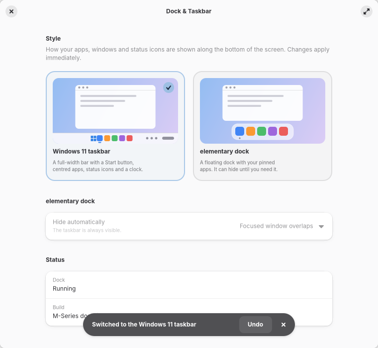
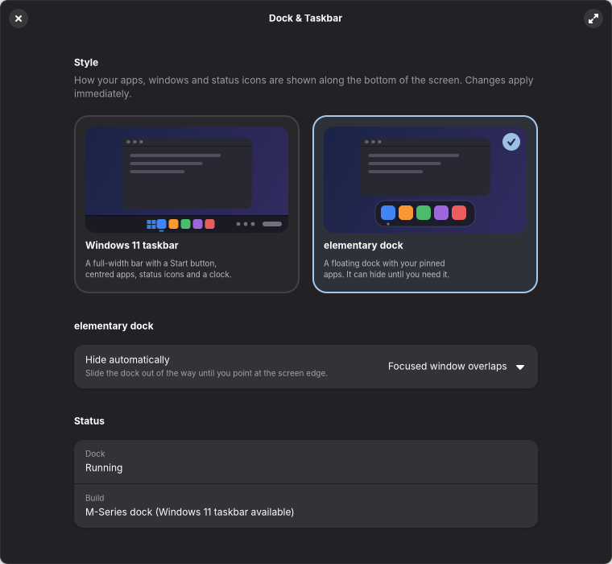
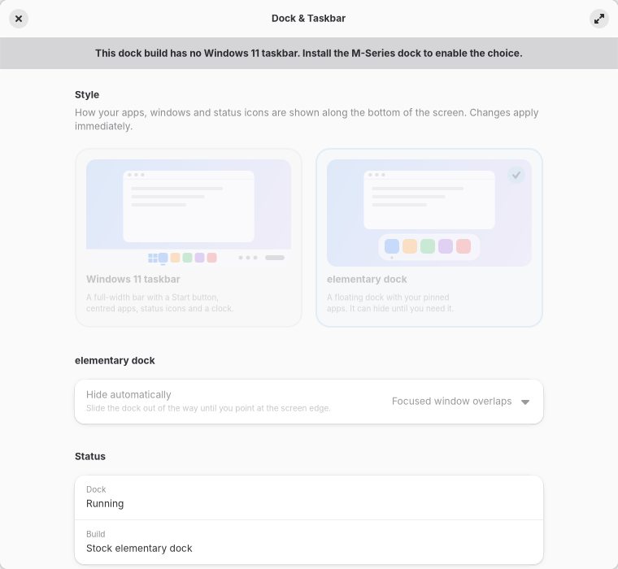

# Dock & Taskbar in System Settings

**Settings → Personal → Dock & Taskbar** switches the dock between the **Windows 11
taskbar** and the **elementary dock**, and sets when the elementary dock hides. It is a
Switchboard plug (GTK 4 + libadwaita, Vala), built like [Work Mode](../work-mode/) and
[Touch ID](../touchid-settings/).

| | |
|---|---|
|  |  |
|  | |

## How it works

The patched M-Series dock (`mseries/dock-taskbar/`) is one binary with one switch: the
`io.elementary.dock` key `taskbar-mode`. It reads the key **live**, so a choice takes
effect immediately, with no restart and no logout. The page only ever writes that key
(and `autohide-mode`); it never starts, stops or restarts the dock.

- **Two cards**, each with a drawn miniature of the real thing (full-width bar with Start,
  centred apps, tray and clock, or a floating dock). The drawings follow light/dark and the
  accent colour and use no image files. Choosing a card applies at once.
- **Confirm, don't assume.** After writing, the page reads the value back and only then
  says "Switched to the …". The toast has **Undo**. If the write didn't stick it says so and
  puts the selection back.
- **Follows other changes.** Work Mode, `gsettings` or another tool changing the key moves
  the selection without the page re-applying anything.
- **Hide automatically** is the dock's own five-way option; it is only enabled for the
  elementary dock, and says so when the taskbar (always visible) is selected.
- **Status** shows whether the dock is running (watches `io.elementary.dock` on the session
  bus, only while the page is visible) and which build is installed.

### States it handles

| State | What the page does |
|---|---|
| M-Series dock | Both cards available. |
| Stock dock (no `taskbar-mode` key) | Banner explains the taskbar needs the M-Series dock; cards disabled; the real hide setting is shown, read-only. |
| Dock not installed | Banner; everything disabled. |
| Owner's opt-out marker (`~/.config/mseries/dock/user-disabled`) | Banner naming the file; read-only. Turning the dock back on stays a deliberate act. |
| Dock not running | Status says "Not running"; choices still save for the next start. |

The Settings process doesn't search the patched dock's private schema directory
(`~/.local/lib/mseries/dock/share/glib-2.0/schemas`), so the model looks there first and
falls back to the system schema, the same way Work Mode does. `Gio.Settings` is only built
after the schema lookup succeeds, because it aborts on an unknown schema.

## Build, test, install

```sh
meson setup build mseries/dock-switcher && ninja -C build && meson test -C build
bash mseries/install-dock-switcher.sh              # build, test, install the plug (sudo for the copy)
bash mseries/install-dock-switcher.sh --uninstall
```

Installing adds one file to Switchboard's `personal/` directory. Nothing is restarted: the
page appears the next time System Settings is opened. Dock settings are left untouched on
uninstall.

`mseries-dock-switcher-preview` (built, never installed) hosts the page in a window for
screenshots: `--screenshot FILE --light|--dark --pick taskbar|dock --delay MS --size WxH
--text-scale N`. Point `MSERIES_DOCK_SCHEMA_DIR` at a fixture schema and set
`GSETTINGS_BACKEND=memory` to leave the real dock alone (the screenshots here did).

## Verification

- Verified: build; 7 unit tests (availability matrix, autohide mapping, live switch with
  change signal, autohide round trip and refusal of unknown values, stock/missing/opted-out
  dock) against fixture schemas and the memory backend; the built `.so` loaded through
  `get_plug` with a `GModule`, constructed, shown and hidden; light, dark, disabled and
  1.5× text screenshots reviewed.
- Not verified: the page inside a live System Settings window on the owner's session, a
  real click against the running dock (the dock's live handling of `taskbar-mode` is
  taken from its patch, `mseries/patches/dock-taskbar.patch`), and keyboard traversal
  with a screen reader. The headless screenshot can catch a CSS transition mid-way; wait
  with `--delay 4500` before trusting a card's highlight.
