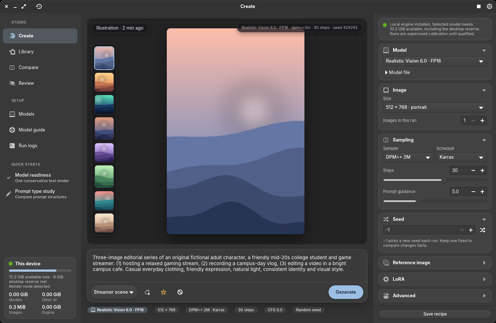
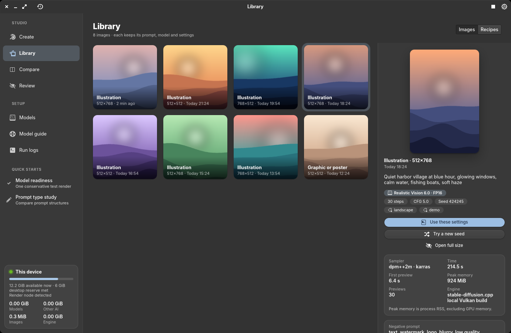

# M-Series Image Studio

Native GTK 4 + Granite 7 application using the repository's Pantheon SDK, pinned to `e15f9272`.
It follows the desktop's elementary stylesheet, font and color preference. The icon and D-Bus
launcher install per user without modifying desktop services.

## Install and open

From the repository root:

```sh
python3 mseries/image-studio/install-user.py
~/.local/bin/mseries-image-studio
```

The app appears as **Image Studio** in Applications. `--no-build` installs an already-built binary.
The executable is installed atomically under `~/.local/libexec/mseries-image-studio/`; updates do not
replace the inode of a running process. Reopen the application to load a newly installed build.

## Design

Image Studio follows elementary OS conventions with a Draw Things-style creative workflow:
a flat header bar, a source-list sidebar (Studio and Setup sections, quick starts, and a live
memory meter for this device) and one scoped stylesheet in `src/style.rs` built on the
elementary stylesheet's named colors, so the accent, light/dark preference and fonts come from
the desktop. Overlays over images use a fixed dark glass so they read on any picture.

| Create | Library |
| --- | --- |
|  |  |

More states: [generating](docs/screenshots/image-studio-create-generating.png),
[light mode](docs/screenshots/image-studio-create-light.png),
[models](docs/screenshots/image-studio-models.png) and
[compare](docs/screenshots/image-studio-compare.png). All screenshots use the fictional demo
data from `rust/mseries-image-studio/tests/demo_data.py`, not real renders.

## Workspaces

- **Create:** a dotted canvas that shows the live projected-latent preview while sampling (status
  and step in a glass pill, progress along the bottom edge) and reopens on the latest image, with
  a history filmstrip down the left edge. A floating prompt dock holds the prompt, prompt type,
  Suggest type, Improve prompt and a collapsible negative prompt, and a pill Generate button.
  Chips under the dock summarize the next run. The inspector groups Model, Image, Sampling (real
  sliders), Seed, Reference image, LoRA and Advanced into collapsible cards with Save recipe pinned
  below. Header Stop cancels the current image, review or remaining sweep; Ctrl+Enter runs the recipe.
  Below about 1100 px the inspector moves into a Settings popover.
- **Library:** a gallery of every image; choosing one opens a detail pane with its prompt, settings,
  measured timing and process memory, provenance, model notes, **Use these settings**, **Try a new
  seed** and a full-size viewer. A Recipes tab holds saved prompt recipes. Completed jobs refresh the
  Library automatically.
- **Models:** SD 1.5 Q4 and Q8, SDXL Turbo FP16, Realistic Vision, the reference appearance bundle and
  Qwen3-VL 2B with its required Q8 vision projector, each a card with an Installed badge;
  revision-pinned, size/SHA-256 verified downloads with a progress bar and cancellation. Use selected
  model loads starter defaults. Engine setup builds pinned stable-diffusion.cpp.
- **Model guide:** task/capability cards, source links, supported settings and local qualification
  limits. Engine support is distinguished from a verified app workflow.
- **Compare:** bounded sequential lighting, step or installed Q4/Q8 model sweeps with fixed seeds,
  saved manifests, per-result settings/measurements and optional vision review.
- **Review:** local Qwen vision rubric and optional visual reference, advisory scores/explanations,
  retained evaluator identity, image digest and a suggested prompt the user can explicitly apply.
- **Run logs:** bounded, read-only structured diagnostics for each render.

The sidebar and Models show app model storage, shared AI model storage, images including previews,
and the app-managed engine/source. Exported copies outside the app directory are not counted.

Data lives in `$XDG_DATA_HOME/mseries-image-studio` (normally `~/.local/share/mseries-image-studio`).
PNG sidecars retain prompts, model receipts, engine revision/arguments, sampler, steps, guidance,
resolved seed, dimensions, tags, timing and memory measurements. Hosted sample settings not exposed
by their provider remain unavailable; displayed editable starter settings do not reconstruct that run.

## Current hardware evidence

One M1 Pro / Honeykrisp trial of SD 1.5 Q4, 512×512, Euler, 8 steps, CFG 7, seed 424242 and batch 1
completed in 55.701 s. Eight real preview frames were produced; first preview took 4.021 s. Peak child
process RSS was 1957 MiB, excluding GPU memory. Minimum observed available host memory was
7308 MiB. Low-step baseline image quality is below the hosted sample project quality.

A sequential Qwen3-VL 2B Q4 / Q8-projector CPU review of that image completed in 94.439 s and
saved an advisory 2.8/5 report. This establishes pipeline operation, not evaluator accuracy.

Local inference is supervised calibration: estimated worker budgets plus a protected 6 GiB desktop
reserve, continuously sampled during work. SD 1.5 Q4 requires 9 GiB available at admission, Q8
9.5 GiB, Turbo 12 GiB; vision review requires 9 GiB. These estimates are not measured peak GPU
allocations. Stop cancels the current run and remaining sweep. Image trials are limited to 15 minutes.
Vision workers are CPU-only, sequential, and unloaded after review; existing services are not replaced.

LoRA, inpainting and reference-conditioned local generation remain unqualified. Q8/Turbo hardware
qualification remains outstanding. The matrix labels these limits. Prompt help uses only the already
running assistant at `127.0.0.1:8766`; it does not launch another text model worker.

## Validation

```sh
CARGO_TARGET_DIR="$HOME/.cache/cargo-target" cargo test --manifest-path rust/Cargo.toml -p mseries-image-studio --lib
python3 rust/mseries-image-studio/tests/adapters.py
dbus-run-session -- env -u WAYLAND_DISPLAY CARGO_TARGET_DIR="$HOME/.cache/cargo-target" GDK_BACKEND=x11 GSETTINGS_BACKEND=memory GSK_RENDERER=cairo xvfb-run -a cargo test --manifest-path rust/Cargo.toml -p mseries-image-studio --test render
```

`M_SERIES_IMAGE_STUDIO_TEST_COMPACT=1` exercises the compact settings popover.

For visual review without touching real data, build the fictional fixtures and run a second
instance beside the installed app:

```sh
python3 rust/mseries-image-studio/tests/demo_data.py /tmp/demo --states   # fixtures, never real renders
XDG_DATA_HOME=/tmp/demo M_SERIES_IMAGE_STUDIO_DEV=1 M_SERIES_IMAGE_STUDIO_TEST_PAGE=library \
  M_SERIES_IMAGE_STUDIO_TEST_SELECT_IMAGE=1 M_SERIES_IMAGE_STUDIO_SCREENSHOT=/tmp/library.png \
  M_SERIES_IMAGE_STUDIO_EXIT_AFTER=4 ~/.cache/cargo-target/debug/mseries-image-studio
```

`M_SERIES_IMAGE_STUDIO_DEV` makes the instance non-unique, `..._TEST_PAGE` picks a page,
`..._TEST_SCHEME=light|dark` previews the other color scheme, and the screenshot hook clears the
backdrop dimming an unfocused window would otherwise show. Render fixtures and
transport tests are not AI inference; hardware measurements above come from the separate actual run.

Sources: [engine and preview support](https://github.com/leejet/stable-diffusion.cpp),
[SD 1.5 quantized files/license](https://huggingface.co/second-state/stable-diffusion-v1-5-GGUF),
[SDXL Turbo author settings/license](https://huggingface.co/stabilityai/sdxl-turbo),
[Qwen vision weights/projector](https://huggingface.co/Qwen/Qwen3-VL-2B-Instruct-GGUF).
