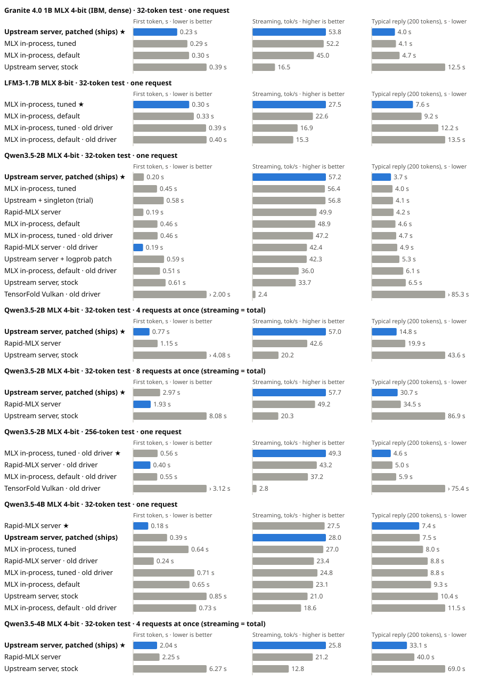

# Local AI engine scoreboard

One table for every engine we run or watch on the M1 Pro. ★ marks the most functional setup per model and length: the fastest decode whose output matched every other engine and whose correctness gate did not fail. Regenerate with `python3 mseries/local-ai/scoreboard.py` after adding a receipt. Tracked in the "Local AI engine scoreboard" issue.



## Measured on this machine

| ★ | Model | Engine | Settings | Tokens | Decode tok/s | TTFT s | Total s | Runs | Same output | Gate | Kernel | Driver | Date | Receipt |
|---|---|---|---|---:|---:|---:|---:|---:|---|---|---|---|---|---|
| ★ | Qwen3.5-2B MLX 4-bit | **MLX (omarchy-mlx, in-process)** | `MLX_OMARCHY_BATCH_WORK=120000` | 32 | **47.19** | 0.46 | 1.13 | 3 | yes | not gated | `7.2.11-elementary-aurora72-wip4` | Honeykrisp Mesa 7faf04c065 | 2026-10-28 | [2026-10-28-engine-compare-short.json](receipts/2026-10-28-engine-compare-short.json) |
|  | Qwen3.5-2B MLX 4-bit | Rapid-MLX 1d09cdb (HTTP server) | `MLX_OMARCHY_BATCH_WORK=120000` | 32 | 42.42 | 0.19 | 0.92 | 3 | yes | not gated | `7.2.11-elementary-aurora72-wip4` | Honeykrisp Mesa 7faf04c065 | 2026-10-28 | [2026-10-28-engine-compare-short.json](receipts/2026-10-28-engine-compare-short.json) |
|  | Qwen3.5-2B MLX 4-bit | MLX (omarchy-mlx, in-process) | `defaults (MLX_OMARCHY_BATCH_WORK fallback 5000)` | 32 | 36.02 | 0.51 | 1.37 | 3 | yes | not gated | `7.2.11-elementary-aurora72-wip4` | Honeykrisp Mesa 7faf04c065 | 2026-10-28 | [2026-10-28-engine-compare-short.json](receipts/2026-10-28-engine-compare-short.json) |
|  | Qwen3.5-2B MLX 4-bit | TensorFold Vulkan PR 1517 (HTTP server) | `serve --backend vulkan --context 1024 --no-thinking` | 32 | 2.40 | 2.00 | 14.92 | 3 | yes | not gated | `7.2.11-elementary-aurora72-wip4` | Honeykrisp Mesa 7faf04c065 | 2026-10-28 | [2026-10-28-engine-compare-short.json](receipts/2026-10-28-engine-compare-short.json) |

## Watched or reported elsewhere (not comparable to the table above)

| Model | Engine | Settings | Decode | Status | Blocker | Source |
|---|---|---|---|---|---|---|
| Qwen3.8-2B (Q4_K_M GGUF, staged) | ANE (omarchy-ane staged decoder) | fp16 / int8 staged programs | 12-16 | reported: 13-inch M1 (H13), not run here | Needs the compiled 38-program H13 bundle and stride-aware layout binding; six incompatible packed surfaces found locally | UZU-AND-ANE-EVALUATION-2026-10-27.md; receipts/2026-10-27-ane-binding-handoff.md |
| Qwen3.8-2B (Q4_K_M GGUF, staged) | ANE (ane-linux-experiments decoder preflight) | 38 ANE submissions per token | 8.23 | reported: M1, peak RSS 8.38 GB, not run here | Memory: does not fit beside the 6 GiB desktop reserve on our 32 GB M1 Pro today | receipts/2026-10-27-ane-qwen-preflight.md |
| Parakeet TDT (dictation encoder) | ANE (whole encoder) | CPU-cluster boost held | 138 ms/encode (GPU 113 ms) | reported: 13-inch M1, not run here | Worth it for CPU and power, not speed | ane-linux-experiments README; UZU-AND-ANE-EVALUATION-2026-10-27.md |
| Qwen3.5-2B MLX 4-bit | TensorFold Vulkan + submit batching | unpublished follow-up to PR 1517 | ~10.6 (M1 Max), ~6.9 (M1) | reported upstream, code not public | Watched in people-watch/branch-watch; re-run engine-compare when it lands | ashhart/TensorFold issue 1420 |
| Qwen3.5 0.8B (Mirai format) | uzu (CPU backend) | backend-cpu, stable Rust | 0.36 | measured here 2026-10-27 | No Linux GPU backend; Metal only | UZU-AND-ANE-EVALUATION-2026-10-27.md |

## How we track upstream

The engines above move fast, so this page is a living record on `dev`, not a one-off report.

1. **Watch.** `people-watch.json` and `branch-watch.json` list the people and repos we follow (Joshua Warren's omarchy-mlx, metal2vk, omarchy-cluster, ane-linux-experiments, TensorFold and its fork). `github-watch.py` runs every 6 hours (`.github/workflows/upstream-watch.yml`) and keeps one "Upstream watch" issue listing unacknowledged pushes, branches and PRs.
2. **Triage.** For each flagged change, decide whether it can affect a row here (new engine, runtime pin bump, kernel or driver change). Record that decision on the scoreboard tracking issue.
3. **Re-test.** Build it in a private prefix (never system-wide), run its own gates first (`tensorfold-vulkan.sh test` / `gpu`, `mlx-gate.py sweep`), then `engine-compare.py` with the same models, prompts and guards.
4. **Publish.** Commit the new receipt JSON, run `scoreboard.py`, and open a PR to `dev` with the regenerated CSV, SVG and this page. Rows are replaced by the newest receipt; old receipts stay for history.
5. **Adopt.** A setting becomes our default only when it holds ★ *and* passes the MLX gate; change defaults in a separate PR.

Rules: everything is documented in our own repo only; we do not post to upstream projects. Rows under "reported elsewhere" are other people's numbers on other hardware and are never ranked against ours.

## Reproduce

- Kernel `7.2.11-elementary-aurora72-wip4` (techmore/ElementaryOS_MSeries-Kernel), Apple M1 Pro 32 GB.
- GPU driver: private Honeykrisp ICD shipped by omarchy-mlx, selected per process only: `VK_DRIVER_FILES=$HOME/.local/share/mlx-omarchy/vulkan/honeykrisp_icd.aarch64.json`. Desktop Mesa is untouched.
- Guards on every run: shared worker lock, 6 GiB desktop memory reserve, 80 °C limit, one engine at a time.
- Same prompt, greedy decoding, no thinking; each run is a fresh process with one warmup, three rotated rounds.
- MLX rows time in-process; server rows time a streamed loopback HTTP request. Compare like with like.

```bash
cd mseries/local-ai
python3 engine-compare.py --model qwen2b            # 32 tokens; add --long for 256
python3 engine-compare.py --model qwen4b --admission-wait-seconds 1800
python3 engine-compare.py --model lfm3
python3 mlx-gate.py reference && python3 mlx-gate.py sweep
./tensorfold-vulkan.sh build && ./tensorfold-vulkan.sh gpu
python3 scoreboard.py
```
