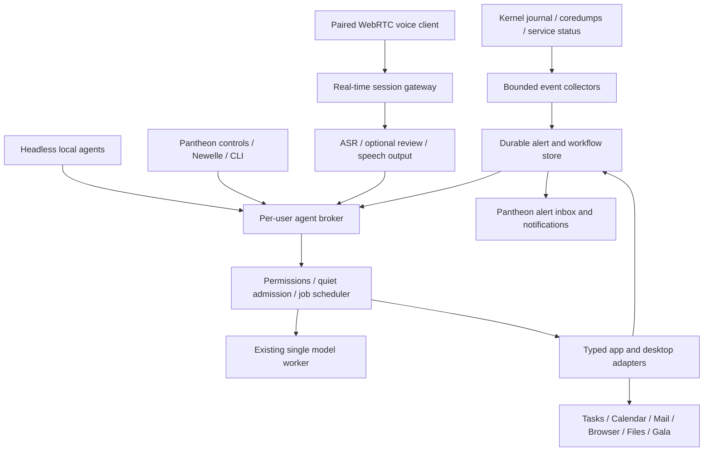

# Pantheon MCP: agent-first desktop and real-time interaction

**Feature proposal — October 18, 2026.** Requested direction: an agent-first Pantheon redesign connecting kernel/app alerts, personal and coding workflows, native desktop actions, and speech-to-text/speech-to-speech through WebRTC. This is a design and delivery plan, not a claim that a new desktop broker, alert agent, voice conversation service or WebRTC endpoint is installed.

## Product intent

Make the operating system's useful capabilities available to agents through a common, inspectable service. The same workflow should work from a headless agent, the Pantheon interface, a voice conversation or an explicitly paired WebRTC client. A chat window is one client of that system. The system must keep working when that window closes.

The owner should be able to say “What needs my attention?”, hear a concise answer, inspect the evidence, and ask for an allowed app action. A kernel GPU fault should appear as an identified system event, not a guessed explanation. “Use this planning page to add a meeting and prepare an email” should produce independently verifiable app objects and an unsent draft. The desktop should expose what each agent is doing, what it can access, and why a job is waiting for the machine to cool.

Keep the existing Pantheon shell and applications usable throughout the rollout. Redesign their agent interfaces and shared interaction model incrementally; do not replace Gala, Wingpanel, the notification server or application data stores in one release.

## Starting point: actual implementation

| Area | Current evidence | Proposed extension |
|---|---|---|
| Local model | One supervised Qwen3.5 4B worker; six-GiB reserve; fan/temperature cooling and hard limits | Shared admission and cancellation for every agent and voice client |
| App tools | Sixteen typed stdio MCP tools; local Tasks/Calendar, scoped notes, separate Brave page reads, local unsent Mail drafts | Brokered adapters with identity, permissions, jobs and verification receipts |
| Fault collection | Live bounded kernel signatures and user coredumps; previous-boot evidence; `recent_faults` read tool | Durable alert inbox, replayable event subscriptions, acknowledgement and rate-limited desktop notifications |
| Speech | Existing native AOP/F5 streaming implementation; offline speech measurements | Explicit conversation mode, optional grammar/translation review, interruptible local speech output |
| Desktop interaction | App launchers and selected native/data-service adapters; synthetic isolated GUI checks | Tested app/window actions through native APIs, accessibility and supported portals |
| Remote/voice transport | No project WebRTC service implemented | Explicitly paired real-time sessions using the same agent broker |

Current Calendar/browser/Mail results remain in [app integration](APP-INTEGRATION.md). Universal app control, live speech insertion across apps, translation, autonomous repair and remote control are not established by those tests. The small model failed repair-advice checks; automatic model diagnosis stays off.

## Upstream parity and performance

The [Omarchy Mac/MX and MLX feature comparison](UPSTREAM-FEATURE-COMPARISON.md) pins current source revisions, compares notification/agent/voice contracts and serving options, and separates locally tested behavior from developer candidates. It identifies new native-GQA work, oMLX/batching opportunities, unsupported placement on this kernel, and rejected numerical shortcuts. These findings govern the next performance experiments; none changes the frozen app-integration cohort.

## Owner priority: three tiers

Delivery order is universal speech-to-text, then a strong troubleshooting and optimization agent, then a low-overhead everyday assistant that serves as the interface to the machine. Gmail is the preferred future mail adapter. WebRTC and the broader Pantheon redesign remain later feature work; they do not delay native dictation.

The **everyday assistant** exposes app actions, attention items, system status and personal workflows through the same typed capability broker. Plain dictation inserts text without an LLM request; interpreting a command is a separate deliberate action. Deterministic routing handles known commands, alert collection and job status. Use the already supervised small model only when language interpretation is needed, with bounded context and cancellable jobs. Do not start another resident model for the interface or keep microphone capture running while idle.

The **troubleshooting and optimization agent** receives bounded evidence bundles and escalated questions. A stronger model is admitted on demand when the six-GiB reserve and quiet limits permit; serialize model ownership or unload the everyday model when required. Persistent improvement means collecting evidence, proposing a reviewable change, measuring it against a baseline, and retaining a rollback and regression result. It does not mean continuously running expensive inference or treating unverified repair advice as an applied fix. The small model's failed diagnosis trials remain excluded from this role.

Qualification must measure idle CPU/RSS and wakeups, first-action latency, model load/unload cost, cancellation, time waiting for quiet admission, fan/temperature and available memory. Test an app-to-app task, an alert explanation and escalation to stronger diagnosis independently. These are acceptance requirements, not measured budgets or a claim that either new agent is deployed.

## Architecture

The **per-user broker** is the primary product boundary. Agents discover versioned capabilities, submit work, subscribe to authorized events, cancel jobs, and retrieve receipts without depending on UI automation. A native local IPC interface can serve Pantheon components; MCP exposes the supported subset to agent clients. Retain stdio for existing Newelle clients. Add authenticated Streamable HTTP only when a browser/paired client needs it, with explicit protocol negotiation and origin checks. Do not silently migrate the working client to a newer incompatible protocol revision. The [MCP transport specification](https://modelcontextprotocol.io/specification/draft/basic/transports/streamable-http) is the reference; pin a reviewed revision before implementation.

Use one durable store for workflow state and a capability registry for adapters. Store object IDs and verification results, not copies of inboxes, entire journals or every application document. An adapter reports supported operations and scope; a model never gains a generic shell by asking for another tool name.

## Agents before interface

Start with three roles that share the service rather than start three resident LLMs:

- **Alert workflow agent:** receives selected events, coalesces related observations, maintains attention state, and offers tested actions. Classification and delivery work without inference. Any requested explanation identifies its evidence and uncertainty.
- **Personal workflow agent:** handles explicitly granted workspace, local task/calendar and draft capabilities. Personal memory belongs to that identity and is inspectable/removable.
- **Coding agent:** works inside a selected project with explicit edit/build permissions. Kernel deployment, boot changes and system configuration remain separate capabilities requiring their own authorized workflows.

Role names do not confer privilege. Each client/agent has an identity, allowed resources, operation scopes, expiry and revocation. Local IPC checks the calling user's identity. A paired device receives a narrowly scoped, revocable session grant. Model output and tool annotations cannot create or widen grants. A background workflow may continue only within the scope and duration already authorized by the owner.

The registry should distinguish read operations, reversible local creation, external side effects and privileged system changes. Existing retry-safe local creates can run under a standing scope. Sending mail, calendar invitations and privileged changes require a concrete final action and the applicable user authorization. Avoid repeated prompts for already authorized steps; show the actual pending action when approval is required.

## Kernel messages and alerts

Build on `crash-watch.py`; do not make the language model tail the entire journal. Collect selected kernel signatures, current-user coredumps and explicitly selected service failures. Add quiet-guard stops and developer-update candidates as separate event sources. A discovered branch is a review candidate, not a system fault or an instruction to install it.

A proposed event envelope contains `event_id`, source, boot ID, journal cursor/source sequence, observed time, occurrence count, subsystem, severity, bounded evidence reference and collection freshness. Keep event identity separate from a deduplication fingerprint. Different boots and genuinely new occurrences must remain distinguishable.

Alert states are **new → seen → acknowledged**, with **resolved** requiring fresh supporting evidence. Acknowledging an alert does not repair the underlying fault. Deduplicate storms into one alert with a count; rate-limit desktop notifications, honor quiet hours, and retain suppressed events in the inbox. Never replay yesterday's crashes as fresh desktop popups after restarting a collector. On journal rotation or a lost cursor, record the gap explicitly. Missing previous-boot data cannot establish that a boot was clean.

Proposed broker operations include `alerts.list`, `alerts.subscribe`, `alerts.acknowledge`, `evidence.read` and `workflows.start/get/cancel`. These are proposed contracts, not names of tools shipped today. Subscriptions need durable resume cursors, bounded queues and backpressure; stdio clients without compatible subscription support can poll a bounded unread list. Agent acknowledgement and collector delivery use transactions so two agents cannot lose or duplicate an action.

A serious new fault can notify the owner with a short factual caption and an Open details action. Do not put full logs or private document text in notifications or speech. There is no automatic restart, kernel replacement, log-derived shell execution or repair loop in the first release.

## Speech and WebRTC

WebRTC provides the real-time audio path for a browser/companion interface and later a paired device. It supports media connections and data channels; it does not define agent permissions or MCP tool semantics. Keep reliable workflow commits and acknowledgements on the broker's authenticated control interface. Optional data-channel events may carry transient status, with sequence numbers and reconnect handling. This separation is our proposed architecture, not an interoperability claim. Reference: [W3C WebRTC](https://www.w3.org/TR/webrtc/).

Start with a same-device browser client and explicit push-to-talk. Require deliberate pairing for another device; no open LAN listener, default TURN relay or cloud speech provider. Signaling, ICE/TURN configuration and token lifetime need their own reviewed implementation. Transport encryption alone does not establish the peer's authority. Stop capture and revoke tool access when the session is revoked, the desktop locks or the user ends the conversation.

Main b20c808 fixed the native capture failure by reading AOP FLOAT_LE correctly; its installed loopback tests report recognition. Human F5-to-app, conversation capture and quiet contention remain acceptance gates. The prepared Unicode insertion bridge now checks both IBus and AT-SPI field metadata; GTK3/GTK4, Qt6 and accessibility-enabled Brave field tests pass, with the original browser password failure retained. It is not activated and does not establish every app or hands-free operation.

Reuse the existing native AOP capture/filter work. A future native conversation client should send finalized utterances to the broker through an explicit capture mode instead of simulating global keystrokes. Preserve F5 dictation as a separate familiar interaction. One microphone session owner prevents competing capture loops. The existing running audio stack is not changed by this proposal.

The pipeline is capture → streaming ASR → finalized transcript → optional grammar/translation review → intent/tool workflow → verified result → optional speech output. Display raw and revised text together. Streaming text already inserted in another app must not be silently rewritten. Treat transcripts as user input only in a deliberate command session; quoted dictation remains content. Recording, thinking, waiting for cooling, acting and speaking need distinct visible states.

Speech-to-speech should support interruption: a new deliberate utterance stops speech playback and cancels obsolete generation, while preserving already committed app actions and their receipts. Test echo rejection before full duplex. Start with half-duplex push-to-talk and an opt-in spoken reply. English Parakeet streaming does not establish multilingual recognition or translation; evaluate those paths separately. Retain raw text when model admission fails. Do not reserve another large model simply to keep a voice interface warm.

See the narrower [speech integration decision](SPEECH-INTEGRATION.md) for current capture limits. WebMCP is a different browser-tool proposal and is not a prerequisite for this WebRTC feature.

## Desktop and application redesign

Prefer app/data APIs with verifiable outcomes: EDS Tasks/Calendar, draft creation followed by native Mail review, scoped files, and managed-browser reads. Extend native Pantheon apps with typed action/state interfaces where practical. This produces better verification than a sequence of coordinates.

For apps without a suitable API, evaluate [AT-SPI accessibility](https://gnome.pages.gitlab.gnome.org/at-spi2-core/libatspi/) and the [Remote Desktop portal](https://flatpak.github.io/xdg-desktop-portal/docs/doc-org.freedesktop.portal.RemoteDesktop.html) as separate adapters. Actual Pantheon/session/backend support must be tested; their existence does not establish working control on this machine. Bind actions to an owned, identified app/window and recheck it before a consequential input. Abort on unexpected focus, a stale element or a changed document. Universal uinput typing is not an adequate authorization boundary.

Pantheon should show the broker's state consistently: a small activity/recording indicator, an alert inbox, an agent/job view, and a control-panel page for grants, audio language/output, resource limits and history retention. A global stop ends this assistant session's capture, speech and pending work; it does not stop owner applications or unrelated jobs. Receipts remain available after stopping. Newelle can remain a front end while these native surfaces develop.

## Workflow correctness and quiet operation

Every write carries a request ID and target identity. Separate prepare, commit and verify stages where an app supports them. Persist a commit receipt before proceeding to the next app. A lost voice connection must not resend a message or duplicate an event. Cancellation stops uncommitted work; it cannot undo an already sent message. Offer only real compensating actions and label irreversible effects plainly.

All roles share the existing model lock and admission policy. Keep the six-GiB desktop reserve, cooling pauses and hard fan/temperature guards. Event collection and notifications must stay lightweight and must not start a GPU worker for every alert. Interactive voice may preempt queued assistant work cooperatively; it must not terminate owner builds or other applications. Hardware/ANE acceleration remains an experiment until correctness, latency and quiet measurements justify it.

Publish end-to-end latency distributions, cold/warm behavior, time spent cooling, 1-second sampled RAM/fan/temperature, CPU cost and idle overhead. Fan RPM is a noise proxy, not a sound-pressure measurement. Separate kernels, app versions, runtime pins and active workload cohorts. Preserve failures, interruption receipts and unsupported paths; never count a cooling interruption as a quality failure or rerun a completed failure to improve the score.

## Delivery and acceptance

| Phase | Deliverable | Exit evidence |
|---|---|---|
| 0: measured adapters | Complete and publish the current Calendar/browser/Mail cohort | Repeated positive and hostile-page trials; independent EDS/draft matches; cleanup; exact Newelle discovery; CI/Pages verified |
| 1: agent service and alerts | Headless broker, identities/scopes, durable events/jobs, bounded alert inbox | Synthetic kernel/app/service replay; restart/rotation/gap tests; storm coalescing; two-agent concurrency; acknowledgement; denied scopes; no automatic inference/repairs |
| 2: native workflows | Shared native app adapters and job/permission surfaces | Cross-process retries, conflicts and cancellation; app/window identity changes; real app readback; isolated GUI evidence; public synthetic receipts |
| 3: local voice | Explicit native capture mode, ASR/transcript review, optional interruptible TTS | Offline reference clips first; then consented human F5/conversation trials; Unicode/layout checks; interruption/echo tests; quiet admission and raw-text fallback |
| 4: WebRTC | Same-device browser session, then explicitly paired device | Permission rejection/revocation, lock/disconnect/reconnect, lost/duplicate messages, bounded buffering, microphone release, no duplicate app commits, measured media-to-result latency |
| 5: wider capabilities | Translation, supported third-party apps and selected desktop actions | Language-specific quality references, real backend support, injection/target-change tests, independent verification and privacy review for each adapter |

Proposed first acceptance stories: a synthetic GPU fault reaches an alert subscriber without waking the LLM; an agent acknowledges it without marking it repaired; a voice request creates one local task and reads it back; a planning-page request produces one meeting and one unsent draft; a WebRTC reconnect returns the existing receipts; a hostile page/log cannot grant itself mail sending, shell access or desktop control.

The phase numbers describe dependencies, not the owner’s delivery priority. Finish universal native dictation first, qualify stronger troubleshooting next, then deliver the lightweight everyday machine interface; introduce the broker and alert foundations as those capabilities need them. The feature remains agent-first: a repeatable headless workflow and its evidence must exist before polishing its Pantheon or voice interface.
