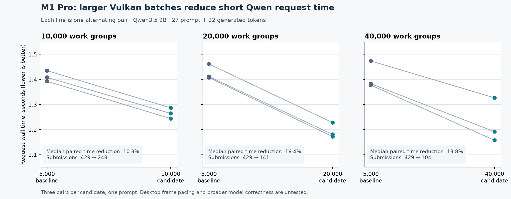

# M1 Pro Vulkan batch-budget experiment — 2026-10-27

## Result

The installed omarchy-mlx runtime already batches work. Its M1 Pro G13S is
uncalibrated in the pinned upstream source and therefore falls back to the
5,000-work-group per-submission budget. We tested the existing process-local
`MLX_OMARCHY_BATCH_WORK` override on the M1 Pro with the private ICD, not
TensorFold's unpublished engine or batching implementation.

| Work budget | Submissions per measured request | Median paired total-time reduction vs 5,000 | Median reported decode tokens/s, baseline → candidate |
| --- | ---: | ---: | ---: |
| 10,000 | 429 → 248 | 10.34% | 36.99 → 43.24 |
| 20,000 | 429 → 141 | 16.37% | 36.98 → 45.98 |
| 40,000 | 429 → 104 | 13.82% | 37.84 → 47.11 |

The median decode rates compare medians of three runs per side, not a
confidence interval; timing and scheduler definitions are MLX's. The measured
submission delta includes prompt prefill and generation, so it is **not** a
per-token count. 40,000 had a slower first candidate run and is not a clear
winner over 20,000. All generated token IDs were identical across the 18 runs.
Token identity on one prompt does not prove general numerical equivalence.

## Method and limits

Each setting used three alternating pairs: baseline/candidate,
candidate/baseline, baseline/candidate. Separate processes each loaded the
same Qwen3.5-2B MLX 4-bit checkpoint at
`93760be4f1f69842a46bc13dbdc0f19e291392a3`, warmed up on the same prompt,
then generated 32 tokens greedily from the same 27-token prompt. The installed
MLX runtime ran on `7.2.11-elementary-aurora72-wip4`, private Honeykrisp
Mesa `7faf04c065`; its C trace ABI size was checked before reading counters.
Six-GiB desktop reserve, shared model lock, 4.5-GiB allowance and 80 C guard
were enforced. The user authorized fan speeds above 3500 RPM. Across the
three sweeps, the lowest sampled available memory was 9.11 GiB, highest fan
2522 RPM, and highest sampled temperature 52.129 C.

These short runs did not measure compositor frame pacing, long contexts,
4B/9B, multi-user concurrency, numerical logits, other prompts or sustained
thermals. Upstream intentionally caps submissions to protect desktop
responsiveness; raising the cap could cause stutter. **Do not enable this as
the default** based on these data. A guarded, process-local 20,000 smoke can be
run with `test-mlx-model-smoke.py --model <local-2B-checkpoint> --admission-gib
4.5 --batch-work 20000`; add `--allow-fan-above-3500` only with owner
authorization. The optional switch was verified by a successful short `19`
response in a separate run. No installed setting, worker or kernel was changed.

Raw per-run timings, counts, token IDs and samples: [10k](2026-10-27-batch-work-ab.json),
[20k](2026-10-27-batch-work-20k-ab.json), [40k](2026-10-27-batch-work-40k-ab.json).
The branch includes the guarded experiment and plotting scripts. To promote a
candidate, measure actual GPU submission duration and desktop frame pacing,
compare logits and output across representative models and contexts, retain
matched timing pairs, and verify reserve/thermal behavior. TensorFold's own
before/after benchmark still requires its unpublished source.
