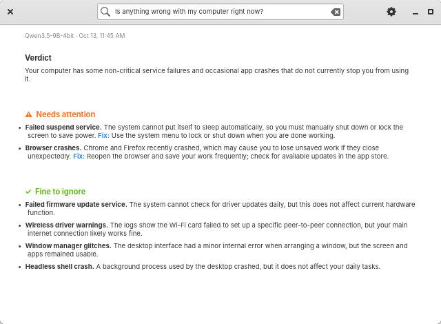

> **Snapshot, 2026-10-13.** The `troubleshooter/` files here are an older copy of `mseries/local-ai/`
> (`troubleshoot.py`, `crash-watch.py`, `troubleshooter-ui.py`) and have drifted from it. The installers use
> `mseries/local-ai/`; do not install from this directory. `panel-network.patch` overlaps the
> `mseries/patches/network-*.patch` series that the installer applies - use one or the other.

# elementary OS on Apple Silicon: network and troubleshooting enhancements

Small, local-first improvements for elementary OS on an M-series Mac. Everything runs on the machine, needs no root to *run*, and is light enough to leave on all day.

| Piece | What it adds |
| --- | --- |
| [Network indicator](#network-indicator) | Live speed graph, per-app and per-host usage, collapsible Wi-Fi list |
| [Usage logger](#usage-logger-netusage) | Tiny background service that records who used the network |
| [Local Troubleshooter](#local-troubleshooter) | Plain-language "what went wrong?" answers from an on-device model |

## Network indicator

A patch to the Wingpanel network indicator, kept as [`panel-network.patch`](panel-network.patch) against the upstream commit in `PINNED_SHA` (elementary/wingpanel-indicator-network).

- **Live throughput.** Current download and upload with a 60-second graph at the top of the popover. Physical interfaces only (Wi-Fi, Ethernet, USB or dock adapters), so VPN tunnels and bridges are not counted twice.
- **Network Usage.** A collapsible section with **Apps**, **Hosts** and **DNS** tabs over **Today**, **7 days** and **30 days**. Click an app to see the hosts it talked to; click a host to see which apps used it. It reads the database only while it is open and on screen.
- **Quieter Wi-Fi list.** Once you are connected, only your network is shown. A chevron next to the Wi-Fi switch reveals the others, and the list folds away again when the popover closes. Not connected? The full list is shown as before.

The patch adds `ThroughputWidget.vala` and `UsageWidget.vala` and changes `WifiInterface.vala`, `PopoverWidget.vala`, `meson.build` and `Indicator.css`. It is built directly on the pinned upstream and does not include the older `patches/network-throughput.patch`, `network-panel-speed.patch` or `network-null-devices.patch` series that `install-network-throughput.sh` applies, so it overlaps with them. Use one or the other; merging the two has not been done.

## Usage logger (`netusage`)

A user service, no root needed. Source and installer in [`netusage/`](netusage).

- Polls `ss` every 5 seconds for per-connection byte counters and the owning process, and skips the poll entirely while the link is idle.
- Turns remote IPs into hostnames from systemd-resolved's query stream, so there are no extra lookups.
- Writes to `~/.local/share/netusage/usage.db` (SQLite, WAL). Minute rows are kept for 2 days and hourly rows for 90 days, and it prunes itself.
- Runs at lowest priority, capped at 10% CPU and 96 MB. Typical use is about 22 MB RAM.

```sh
netusage/install.sh
```

**Limits.** Only TCP has per-socket byte counters, so QUIC/HTTP3 traffic is not attributed to apps; the speed graph still shows the true total. Connections not owned by your user appear as "(other)". A connection that closes between polls can lose its last few seconds.

## Local Troubleshooter

<picture>
  <source media="(prefers-color-scheme: dark)" srcset="docs/screenshots/troubleshooter-report.png">
  
</picture>

A GTK4/Granite app that answers "what went wrong?" using a model that runs on this Mac. Logs are never uploaded. Source in [`troubleshooter/`](troubleshooter).

- **Plain-language reports.** A one-sentence verdict, then **Needs attention** (each item with its own **Fix:**) and **Fine to ignore**. Items whose fix is "nothing to do" are moved to *Fine to ignore* automatically, and duplicates are dropped.
- **Cleaner evidence.** Repeated log lines are collapsed, known-harmless noise is filtered, and crashes read "4 hours ago" instead of raw timestamps.
- **Ask from the title bar.** Type a question and press Enter. Options (previous boot, performance check, free model memory when done) and tools live in one menu.
- **Cancel any time.** Progress shows the current step and elapsed time.
- **Crash notifications.** The crash watcher tells you when an app crashes. With auto-diagnose on it follows up when the diagnosis is ready; otherwise the notification has an **Analyze** button. Create `~/.local/state/mseries-troubleshooter/no-notify` to turn them off.

<picture>
  <source media="(prefers-color-scheme: dark)" srcset="docs/screenshots/troubleshooter-empty.png">
  
</picture>

The model is small, so treat reports as a plain-English summary rather than a verdict. The **Show Evidence** switch in the menu shows exactly what it was given. Suggested commands are never run for you.

## Install

Pieces are installed independently.

```sh
# Usage logger
netusage/install.sh

# Network indicator (needs the wingpanel and granite dev packages)
git clone https://github.com/elementary/wingpanel-indicator-network panel-network
git -C panel-network checkout $(cat PINNED_SHA) && git -C panel-network apply ../panel-network.patch
cd panel-network && meson setup build --prefix=/usr && ninja -C build
sudo install -m644 build/libnetwork.so /usr/lib/aarch64-linux-gnu/wingpanel-9/libnetwork.so
pkill -f '^io.elementary.wingpanel'   # the session restarts it

# Local Troubleshooter
install -Dm755 troubleshooter/mseries-troubleshooter-ui ~/.local/libexec/mseries-troubleshooter-ui
install -Dm755 troubleshooter/mseries-crash-watch       ~/.local/libexec/mseries-crash-watch
install -Dm755 troubleshooter/mseries-troubleshoot      ~/.local/bin/mseries-troubleshoot
install -Dm644 troubleshooter/org.techmore.MSeries.Troubleshooter.desktop ~/.local/share/applications/
install -Dm644 troubleshooter/org.techmore.MSeries.Troubleshooter.svg ~/.local/share/icons/hicolor/scalable/apps/
gtk4-update-icon-cache -f -t ~/.local/share/icons/hicolor
```

The Troubleshooter also expects the on-device model service (`mseries-troubleshooter-model.service`) and, for the checklist, `mseries-verify`, which are set up separately.

See [CHANGELOG.md](CHANGELOG.md) for what changed and when.
