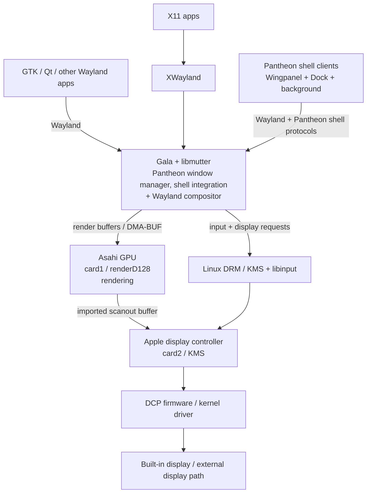
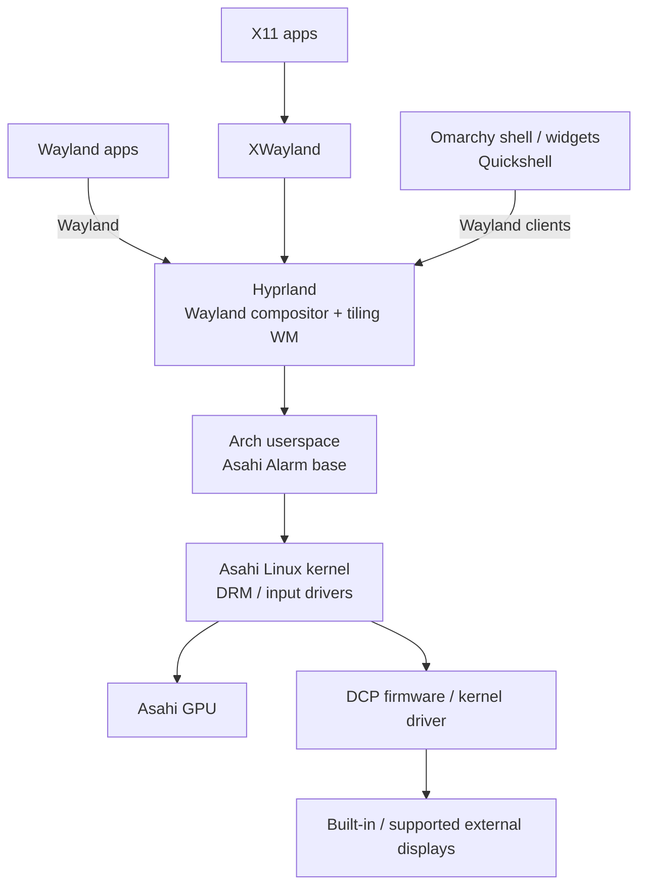
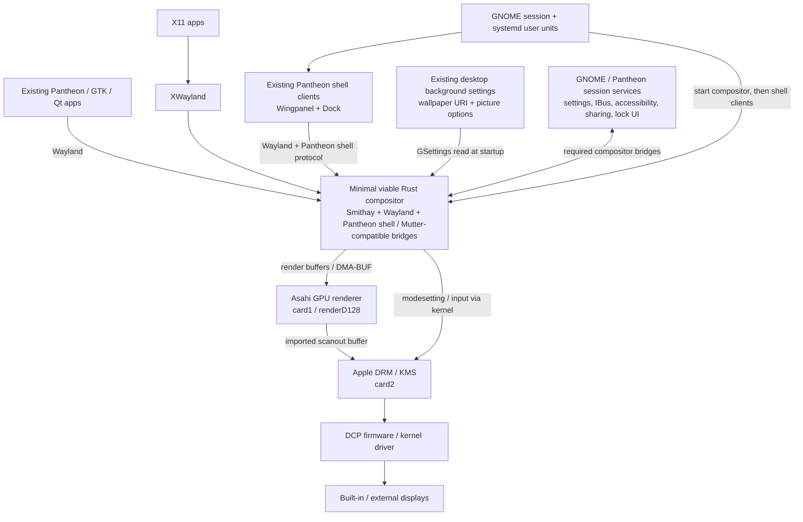

# GUI stack comparison and development status

This page shows where the compositor sits in the desktop stack, how the
M-series prototype differs from the current Pantheon stack, and what the
native development session has proved so far. It is a working architecture
map, not a claim of feature parity.

## Existing elementary OS / Pantheon on M-series

Gala supplies Pantheon's window manager and compositor integration on top of
libmutter. Mutter provides the Wayland display-server work and delegates
device-level display support to Linux KMS/input drivers. Applications and
shell surfaces are Wayland clients; X11 applications use XWayland. On this
M1 Pro, rendering and display scanout use different DRM devices.

The diagram is simplified: Gala is built against libmutter and uses its
compositor APIs, so replacing Mutter under Gala is not a binary-compatible
swap. Our Rust prototype keeps the existing shell applications as clients and
implements the small set of compositor and shell-facing contracts it needs.
The M-series graphics path is also layered: the compositor cannot replace
missing kernel or firmware display support. The Asahi M1 feature matrix lists
both GPU and DCP support in `linux-asahi`.

## Omarchy running on Asahi

Omarchy is an Arch-based desktop setup built around Hyprland and Quickshell.
Its manual describes running it on Asahi Alarm on M1/M2 as a community
workaround that takes effort; this is a different shell and workflow from
Pantheon, not a Pantheon compositor port.

## Proposed minimal viable Pantheon compositor for M-series

Keep the Pantheon apps, shell clients, and settings services. Replace the
Gala/libmutter compositor layer with a Rust/Smithay process that speaks
Wayland, implements the Pantheon shell protocol and required GNOME session
bridges, and uses the existing Asahi rendering and Apple KMS path. Session
management starts the compositor before Wingpanel and Dock. Wallpaper,
lock-screen UI, accessibility, sharing, and other services remain separate
desktop components; the compositor must provide the protocols and hooks their
required workflows need.

**Current implementation detail:** the session file starts the compositor;
new user units are staged to start Wingpanel and Dock after it. `After=` orders
process startup but does not yet wait for the panel to map or prove the
`wait-for-n-panels=1` shell-launcher contract. Package `0.1.0+git8c784dc` was
installed for a second native qualification attempt, but its session handoff
did not reach the compositor or shell units. The Dock unit now skips startup
when the existing user-disabled marker is present,
honoring the user's opt-out even though it invokes the distro executable by
absolute path. The compositor loads the configured local wallpaper, renders it
behind windows, and honors the `zoom` crop mode. It polls for URI or crop-mode
changes every two seconds and requests a redraw; this path is build-checked but
not runtime-qualified on native output. A private D-Bus/dconf + Xvfb smoke
changed the wallpaper URI during compositor runtime; logs showed the changed
selection and new image loading. Installed package `0.1.0+git8c784dc` includes
the wallpaper renderer, live wallpaper settings watcher, shell units, and Dock
opt-out guard. Its SHA-256 is
`a83d4709064bc447ecd24909a4d9a0830d5f168ee20b62e468e23557e5257329`. In the
nested Winit backend, the default transform is set to compensate
for the framebuffer orientation observed under Xvfb; this produced an upright
wallpaper and top Wingpanel in a fresh nested run. It does not alter the native
DRM output transform.

**Development shell smoke:** the current release build rendered installed
Wingpanel 8.0.4 across the top and the stock `/usr/bin/io.elementary.dock`
along the bottom, over the wallpaper, in an isolated Xvfb session. Its Wayland
trace shows the Dock binding the Pantheon panel protocol, requesting the bottom
anchor and submitting shared-memory buffers. The normal local Dock command is
a wrapper; its existing user-disabled marker makes it run `sleep infinity`, so
the earlier “Dock process alive” check was a false positive. The marker remains
untouched, and the visual test launched the stock executable directly only
inside the private session. Hide/reveal also passed in private profiles using
both `overlapping-focused` and `overlapping-window` (the user's saved value): a
maximized GTK window hid the Dock, bottom-edge pointer motion revealed it over
the window, and closing the window restored it. The user's live configuration
was not modified. Native-session appearance remains unqualified. No Gala
session was replaced.

## What is complete and what has been tested

| Area | Evidence | State |
| --- | --- | --- |
| Rust compositor and opt-in session package | Smithay prototype; nested Winit and native DRM backends; installed ARM64 package includes wallpaper, shell units and Dock opt-out guard; compositor remains separate from the default Gala session | Builds; latest session handoff fell back before compositor start; native shell service runtime remains open |
| Native display path | Experimental LightDM login reached the M1 Pro internal display; kernel DRM state showed compositor-owned AR30 framebuffer at 3024×1964 | Native internal-panel scanout passed once |
| Session recovery | Five-minute LightDM rollback returned to Gala; Wingpanel and background came back | Automatic rollback passed once |
| XWayland | Private Xvfb Zenity window mapped and accepted synthetic keyboard input; exposed through window-list D-Bus | Isolated smoke passed |
| Nested text input | Private GTK Wayland field accepted an IBus/Mozc Japanese commit | Isolated smoke passed; native input remains unqualified |
| Pantheon panel protocol | Wingpanel connected in private nested Wayland, requested a top panel, attached shared-memory buffers and rendered upright after the nested Winit transform correction | Nested visual smoke passed; panel absent from native session |
| Pantheon shell clients | Current release rendered Wingpanel at top and stock Dock at bottom in isolated Xvfb. Hide/reveal passed with both private `overlapping-focused` and `overlapping-window` profiles; the latter matches the host's saved value. In native package `0.1.0+git8023955`, Wingpanel's user service became active; the Dock service was intentionally skipped by the existing `~/.config/mseries/dock/user-disabled` marker | Nested visual and hide/reveal smoke passed; native Wingpanel process is active, but native appearance has not been visually confirmed. Dock remains opted out by the user's saved marker |
| Gala action compatibility | Existing Gala compatibility D-Bus path accepts `PerformAction` values | Actions 2 (toggle maximize) and 3 (hide/minimize) passed private Xvfb/Winit Wayland D-Bus smoke; XWayland and native qualification remain open. Action 4 launches the configured Wingpanel main-menu command; build-checked, runtime open. Action 1 (multitasking overview) remains unsupported |
| Desktop wallpaper | Loaded the configured 5000×2813 elementary wallpaper and captured it behind a GTK Zenity window in isolated Xvfb; a private dconf/Xvfb run changed the URI while running and logs confirmed the new image loaded | Nested visual and settings-reload smokes passed; native output and rendering remain open |
| Native Rust session handoff | Package `0.1.0+git8023955` was installed on 2026-10-19 and selected through LightDM. GNOME entered `pantheon-rust-wayland`; its session target, compositor service and user manager became active. The compositor created `wayland-0`, initialized native DRM/EGL, loaded the configured 5000×2813 wallpaper and reported the compositor ready | Wrapper handoff succeeded on this run. Startup-to-usable time is still not measured; a bounded five-minute LightDM rollback was armed and is scheduled to restore Gala |
| Startup timing | On the last OS boot, `systemd-analyze` reported 20.838 seconds to `default.target` and 10.465 seconds to `graphical.target`. In the Rust run, LightDM started at 11:53:01 and the compositor service was active by 11:53:02. The user reports boot/login still feels over a minute | These measurements do not include firmware-to-kernel time or prove login-to-usable. Portal D-Bus calls later timed out at 120 seconds; separately time firmware, greeter, session, shell and first usable interaction |
| Native full desktop | In the `0.1.0+git8023955` session, Wingpanel service/process was active and the configured launcher D-Bus action returned successfully. The Dock service was skipped by the existing user opt-out marker. During handoff, systemd skipped `xdg-desktop-portal` activation while `WAYLAND_DISPLAY` was unset; portal clients then timed out. Native IBus portal activation also failed. Portal services activated after returning to Gala. Compositor logs include repeated XWayland `BadWindow` errors and Wingpanel portal/surface-loss warnings. Source now publishes `WAYLAND_DISPLAY` and queues portal startup after compositor readiness. A matching `0.1.0+git02447cb` ARM64 package built locally but has not been installed or qualified | Native session entry, internal output and wallpaper load passed; portal ordering change remains unqualified pending a native login. Native IBus, full visual shell and interaction qualification remain open. Do not remove the Dock opt-out marker without the user's choice |
| Native keyboard, pointer, external display, lock/unlock, sharing, accessibility, crash recovery | No end-to-end qualification in the native session | Open |
| Performance, power, reliability | Thirty-second internal-panel idle snapshots: Gala `gala` averaged 11.08% of one CPU core and 178,720 KiB RSS; Rust compositor averaged 11.12% and about 173,531 KiB RSS. Rust Wingpanel added about 472,560 KiB RSS and averaged about 1.19% CPU. Battery telemetry was unavailable. Raw CSVs are in [`metrics/`](metrics/) | Initial observations only: compositor CPU is effectively unchanged and its RSS is slightly lower, but session age/state and shell composition are not fully matched. No GPU/power data, latency, representative workload, or crash-free soak. Do not claim the migration is faster or more reliable |

The current login observation is useful development evidence, not a daily-use
readiness result. Continue testing in the isolated experimental session while
Gala remains the working fallback. The next development gate is visual and
interactive qualification of Wingpanel, plus a separate Dock run only if the
user opts in. The earlier compositor startup timing does not explain the
owner's slower overall login; capture session, compositor, Wingpanel, Dock, and
wallpaper timing separately.
The existing user-disabled Dock marker should remain in effect unless the user
explicitly chooses to re-enable Dock in the desktop session.
After that, measure the same startup, idle and representative workloads under
Gala and Rust, and record crashes and recovery behavior.

## References

- [Gala upstream README](https://github.com/elementary/gala/blob/main/README.md)
- [Mutter upstream README](https://github.com/GNOME/mutter/blob/main/README.md)
- [Omarchy manual](https://omarchy.org/manual/)
- [Omarchy on Asahi manual](https://omarchy.org/manual/omarchy-on/)
- [Asahi Linux M1 feature support](https://github.com/AsahiLinux/docs/blob/main/docs/platform/feature-support/m1.md)
