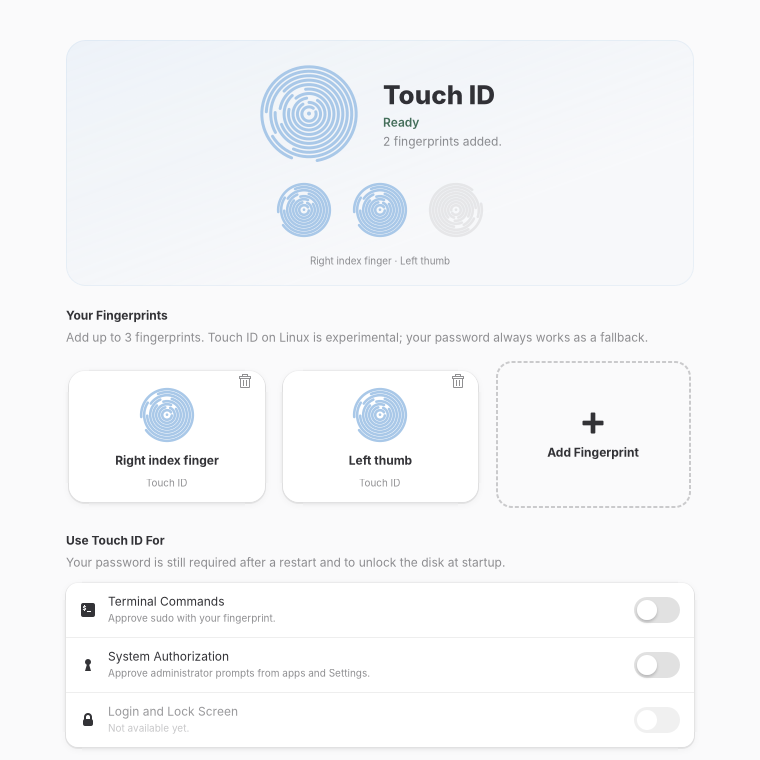
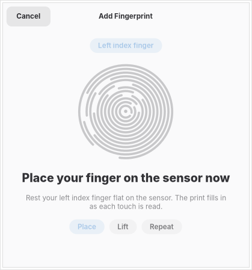

# Touch ID in System Settings

**Settings → Personal → Touch ID**, modelled on macOS *Touch ID & Password*: a list
of enrolled fingerprints with **Add Fingerprint**, then **Use Touch ID For** switches
for what a finger may approve. It is a Switchboard plug (GTK 4 + libadwaita, Vala),
built like [Work Mode](../work-mode/). It replaces the old stand-alone GTK 3 app
in `aurora-sep/` for day-to-day use.

| | |
|---|---|
|  |  |

## What it does

- **Hero:** one glance at where Touch ID stands (Ready, Not set up, Needs attention, or "Can't unlock yet"), a row of
  three prints (each enrolled finger has its own ridge pattern, empty slots are dim), and the single call to action when
  nothing is enrolled.
- **Driver status:** reads the Secure Enclave driver's `diag/` attributes. A banner and the hero say plainly when the
  sensor is not ready or when matching is blocked (the xART guard on this Mac), and a Details section lists every attribute.
- **Add Fingerprint sheet** (an `Adw.Dialog`): people click Add with a pointer, so it does not assume a finger is
  already on the sensor. It says "Getting the sensor ready…", then, once the sensor is listening, **"Place your finger
  on the sensor now"** with a ripple that invites the first touch and a nudge if nothing arrives for 15 seconds. If fprintd
  reports `finger-present` / `finger-needed` the sheet follows them live ("Hold still", "Lift, then place it again");
  otherwise a timed Place / Lift cue stands in. Each accepted touch ripples and fills the print; success becomes a green
  seal with a check. Cancel, Escape and closing all stop the enrolment and release the sensor. The fill is an estimate:
  the sensor reports 37 stages but a real enrolment finished in about eight touches.
- **Fingerprints:** tiles for what fprintd has for you, and a dashed Add tile. Up to three fingers; the next free
  finger is chosen for you. **Remove** asks first.
- **Terminal Commands / System Authorization:** add or remove `pam_fprintd` for `sudo`
  and `polkit-1` through `pkexec` + `mseries-aurora-touchid-apply-pam --only <service>`.
  The switches show what `/etc/pam.d` really contains after the helper runs. They cannot be turned on while no finger is
  enrolled, the sensor is not ready, matching is blocked, or the helper is missing; the handler re-checks this, not only the greyed-out row. The password always remains the fallback.
- **Login and Lock Screen:** shown but disabled. The lock screen's PAM service is not
  identified yet (see `aurora-touchid-state.md`).
- **Unavailable states:** no `/dev/sep-bio` (wrong kernel), no fprintd device, or fprintd
  not answering each show a plain explanation and **Check Again** instead of hanging.

## Safety choices

- The sensor is probed only when the page is opened, never when Settings starts, and every
  D-Bus call is asynchronous.
- One enrolment per sheet and **no retry button** after a failure: the Secure Enclave has a
  device-wide anti-replay counter that enrol/delete loops advance (`aurora-sep/README.md`).
- Closing or cancelling the sheet always sends `EnrollStop` then `Release`.
- Nothing writes to PAM until a switch is turned on, and the helper backs up each file first.
- Boot-time disk unlock is unchanged: the enclave is asleep that early and there is no TPM.

## Install

```bash
bash mseries/install-touchid-settings.sh              # build + install (sudo for /usr)
bash mseries/install-touchid-settings.sh --uninstall  # fingerprints are kept
```

Needs `valac meson ninja-build libswitchboard-3-dev libgtk-4-dev libadwaita-1-dev libgee-0.8-dev`
and `fprintd`. Settings picks the plug up the next time it is opened. Install also removes the
per-user launcher of the old stand-alone app.

## Tests (no real sensor, no real /etc/pam.d)

```bash
bash mseries/touchid-settings/tests/test-pam-helper.sh     # helper: per-service, idempotent, backups
meson setup /tmp/tb mseries/touchid-settings && ninja -C /tmp/tb
mseries/touchid-settings/tests/run-ui-tests.sh /tmp/tb /tmp/tb-shots
```

`run-ui-tests.sh` starts `tests/fake_fprintd.py` on a private session bus, runs the page in
`mseries-touchid-preview` on a virtual X display and checks: unavailable/empty/enrolled states,
the `sudo` switch writing only `sudo`, the enrol sheet claiming then releasing the sensor, and
saves light/dark screenshots. `MSERIES_TOUCHID_TEST=1` is what points the page at the fake;
it is a test hook, not a user option.

## Audit (2026-10-21)

Checked against fprintd's real `EnrollStatus` names, Switchboard plug conventions and the repo's UI
checklist (light/dark, narrow window, 1.6x text, keyboard, accessible names). Fixed: the sheet handles
`enroll-too-fast`, `enroll-swipe-too-short` and `enroll-duplicate`; Escape cancels the sheet; instruction
changes are announced to screen readers; search results carry real locations; Remove warns against repeated
remove/re-add cycles; SPDX headers (GPL-3.0-or-later, matching the repo). Known gaps: strings are not yet
translatable (no gettext domain, same as Work Mode); no live "place/lift" cue from fprintd's
`finger-needed`/`finger-present` properties (unknown whether the SEP driver sets them); per-finger delete uses
fprintd's deprecated `DeleteEnrolledFinger` because the replacement deletes every finger.

## State on the J314S (2026-10-21)

The page reads the driver's `diag/` attributes and says so when `matching` is `blocked` or the sensor is not
ready; the real reason on this Mac is the xART guard, see [../aurora-sep/XART-GUARD.md](../aurora-sep/XART-GUARD.md).

## Not verified

Enrolment and matching against the **real** Secure Enclave from this page are not yet run; the
fake exercises the page, not the sensor. First real enrolment follows
`aurora/unified72/BOOT-TRIAL.md` guidance: fprintd only, xART protections left on.
