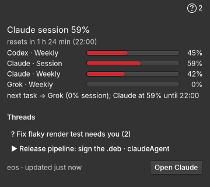

# Wingpanel indicator

The at-a-glance view of the T3 server on the panel. T3 Code itself has no desktop tray or menubar
indicator (only a phone widget), so this is the only one.

- **Panel:** the app's symbolic icon with a badge: the number of pending permission prompts, or a dot
  while a thread runs (the icon turns into a question mark when something needs you). Hovering shows
  the selected chat provider's quota/reset summary and any waiting prompt or running-thread count.
- **Popover:** only the provider selected in full chat, with the plan window nearest exhaustion and
  its reset countdown ("Codex session 59% · resets in 1 h 24 min (22:00)") and that provider's
  remaining windows as gauges (green under 60 %, amber under 90 %, red above). It then lists pending
  prompts ("needs you") and running threads. Rows show the title and, when available, the model on a
  separate caption line. The activity list scrolls inside a 260-pixel viewport when it grows. Other
  provider accounts remain in Settings. Clicking a thread opens it in the app through
  `gapplication action io.github.techmore.ClaudePantheonRs open-thread '<id>'`, where the prompt is
  answered. A bottom bar shows the server and the feed's freshness, and an **Open Full Chat** button.



It reads `~/.cache/claude-pantheon-rs/status.json`, which the client writes whenever the shell or the
provider snapshot changes (`src/status.rs`, schemaVersion 1), and watches it with a `FileMonitor`. A
session D-Bus name watch marks the cached feed stale if the client exits before writing its shutdown
snapshot. There is no polling or second connection to the server.

## Build, test, install

```sh
./install.sh              # meson build, headless probe, sudo install; the panel loads it at next login
./install.sh --restart    # the same and restart Wingpanel now (only when the owner asks)
./install.sh --uninstall
bash mseries/install-claude-pantheon-indicator.sh   # from the repo root, installs the build deps first
```

Wingpanel 8/9 loads indicators only from `pkg-config --variable=indicatorsdir wingpanel-9`
(`/usr/lib/aarch64-linux-gnu/wingpanel-9` here); there is no per-user indicator directory, so the
copy needs sudo. Build requirements: `meson ninja-build valac libwingpanel-dev libgranite-7-dev
libjson-glib-dev libgee-0.8-dev`.

The probe (`probe/probe.vala`, `meson test`) builds the indicator from `probe/status-fixture.json`
at a fixed instant, checks the headline, countdown, gauges, prompt badge and rotation line, then renders
the connected snapshot with no client D-Bus owner and verifies that cached activity becomes disabled
last-known data. `probe/stale-status-fixture.json` covers a normal offline snapshot. With
`PROBE_SHOT=<png>` the probe renders the panel widget and popover (the capture above was made under Xvfb
with the cairo renderer).
